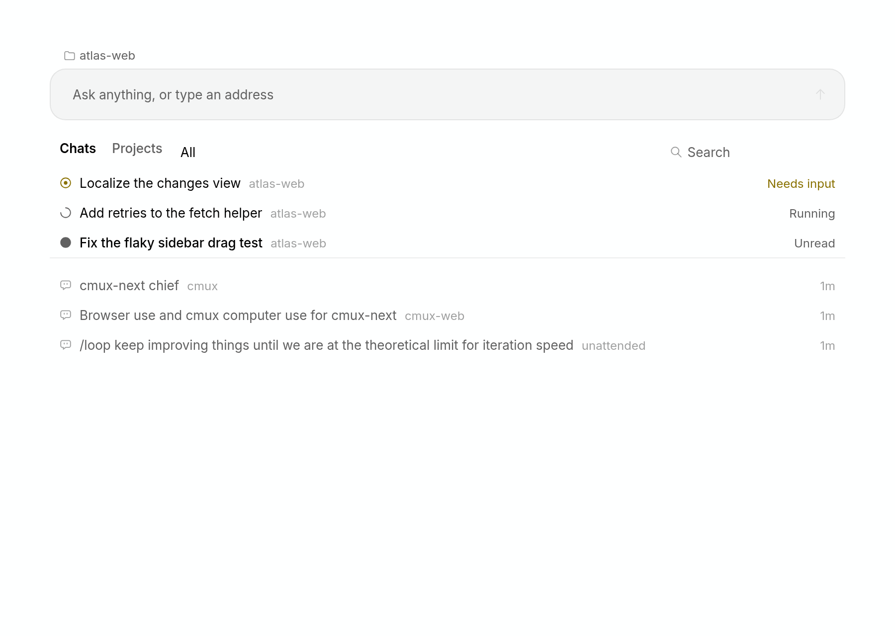

# Threads New Tab



A New Tab page with the field on top, the tabs you closed last under it, and every chat as a quiet list, newest first: Chats or Projects, a filter (All, Working, Needs input, Done) and a search.

cmux used to ship this page as its `threads` New Tab template. It is a look now: a cmux app that
draws the whole New Tab page (`cmux.newtab/1`), built only from public surfaces, so you can
copy any part of it.

| File | What it does |
| --- | --- |
| `cmux-setup.json` | Sets `tabs.newTabApp` to the app below, so every New Tab draws it |
| `customize/cmux-app.json` | The app: it implements `cmux.newtab/1` and asks for the scopes it uses |
| `customize/main.js` | The page: the field, Recently Closed (`closed.list`) and the chats (`agent_chat.list`, read again on `agent_chat.changed`) |
| `SHOTS.md` | The page before (the built-in template) and after (this look), state by state |

```sh
cmux setup install github.com/manaflow-ai/cmux-newtab-threads-look
cmux setup remove manaflow-ai/newtab-threads-look
```

Return in the field does what cmux's own field does (`newTab.submit`): a prompt starts a chat,
an address opens a browser, `!cmd` opens a terminal. A click on a chat opens it; a click on a
closed tab reopens it. The reads are granted at install; starting, opening and reopening need
`actions:run` and `closed:write`, which you turn on in Settings > Apps.

While it is installed, its `customize/` app stands in for your own customize views, if you have
any; `cmux setup remove` puts yours back and your New Tab page with them.

What does not match the built-in template yet, and the API each needs, is in [SHOTS.md](SHOTS.md).

License: MIT.
